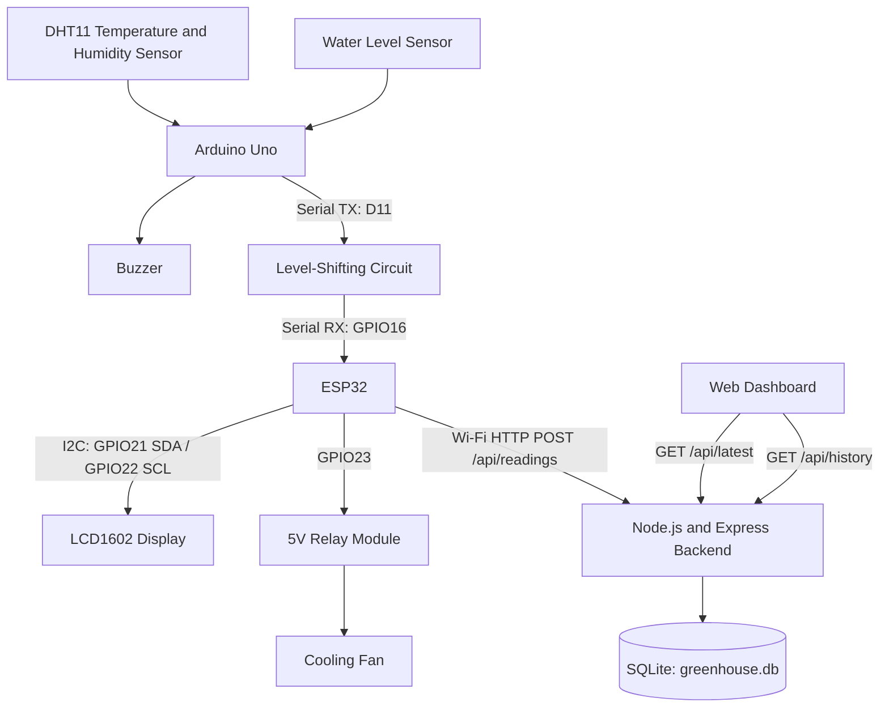

# Greenhouse Care System — Architecture

## 1. Overview

The Greenhouse Care System monitors temperature, humidity, and water level using an Arduino Uno and ESP32. It displays readings on an LCD, activates a buzzer for low water, controls a cooling fan through a relay, and sends sensor data over Wi-Fi to a Node.js and Express backend. The backend provides API endpoints for the dashboard and stores historical readings in SQLite.

## 2. System Architecture

## 3. Sensor Data Flow

1. The DHT11 measures temperature and humidity.
2. The water-level sensor measures the reservoir level.
3. The Arduino Uno reads the sensor values and checks the water-level threshold.
4. The Arduino activates the buzzer when the water level is below the configured threshold.
5. The Arduino sends sensor data to the ESP32 through serial communication.
6. The ESP32 updates the LCD and sends readings to the backend over Wi-Fi.
7. The backend validates the API key and sensor data.
8. The backend updates the latest reading and periodically saves historical readings to SQLite.
9. The dashboard requests the latest reading and saved history from the backend.

## 4. Hardware Components

| Component | Purpose |
|---|---|
| Arduino Uno | Reads sensors and controls the low-water buzzer |
| DHT11 | Measures temperature and humidity |
| Water-level sensor | Detects reservoir water level |
| Buzzer | Alerts when water is low |
| ESP32 | Handles Wi-Fi communication and LCD updates |
| LCD1602 I2C | Displays system information |
| Relay module | Switches the cooling fan |
| Cooling fan | Provides cooling |
| Level-shifting circuit | Protects the ESP32 serial input from the Arduino's higher TX voltage |

## 5. Communication Connections

- Arduino D11 TX connects to the ESP32 GPIO16 RX through the level-shifting circuit.
- Arduino and ESP32 share a common ground.
- LCD SDA connects to ESP32 GPIO21.
- LCD SCL connects to ESP32 GPIO22.
- Relay input connects to ESP32 GPIO23.
- ESP32 communicates with the backend over Wi-Fi using HTTP.

Verify these connections against the final hardware and firmware before submission.

## 6. Backend API

| Method | Endpoint | Purpose |
|---|---|---|
| POST | `/api/readings` | Receives sensor readings from the ESP32 |
| GET | `/api/latest` | Returns the latest available sensor reading |
| GET | `/api/history` | Returns up to 50 saved readings, newest first |

The POST endpoint requires the `x-api-key` header. Invalid or missing keys return HTTP 401. Invalid sensor data returns HTTP 400. Database processing failures return HTTP 500.

## 7. Database Structure

The SQLite database uses a table named `readings`.

| Column | Type | Description |
|---|---|---|
| id | INTEGER | Primary key; auto-incrementing identifier |
| temperature | REAL | Temperature reading |
| humidity | REAL | Humidity reading |
| water_level | INTEGER | Water-level sensor value |
| fan_status | TEXT | Reported fan status |
| low_water | INTEGER | Low-water indicator |
| created_at | DATETIME | Timestamp created by SQLite |

## 8. Data Storage Behavior

The backend keeps the newest reading in memory for the live dashboard. It saves a historical record on the first accepted reading after startup, then saves at most once every 60 seconds.

The backend loads the most recently saved database row when it starts. The in-memory history timer resets whenever the server restarts.

The backend records the fan status reported by the ESP32; it does not independently control the fan.

## 9. Security Notes

The backend uses an API key to authenticate incoming sensor readings. The default fallback key in the current server code is `change-this-key`. Change this value or configure the `GREENHOUSE_API_KEY` environment variable before exposing the server to an untrusted network.

## 10. Related Documentation

- `README.md` — Project overview and setup instructions
- `API_SPECIFICATION.md` — API endpoint documentation
- `testing.md` — API testing instructions
- `ADR-001.md` — Architecture decision record
- `ADR-002.md` — Architecture decision record
- `ADR-003.md` — Architecture decision record
